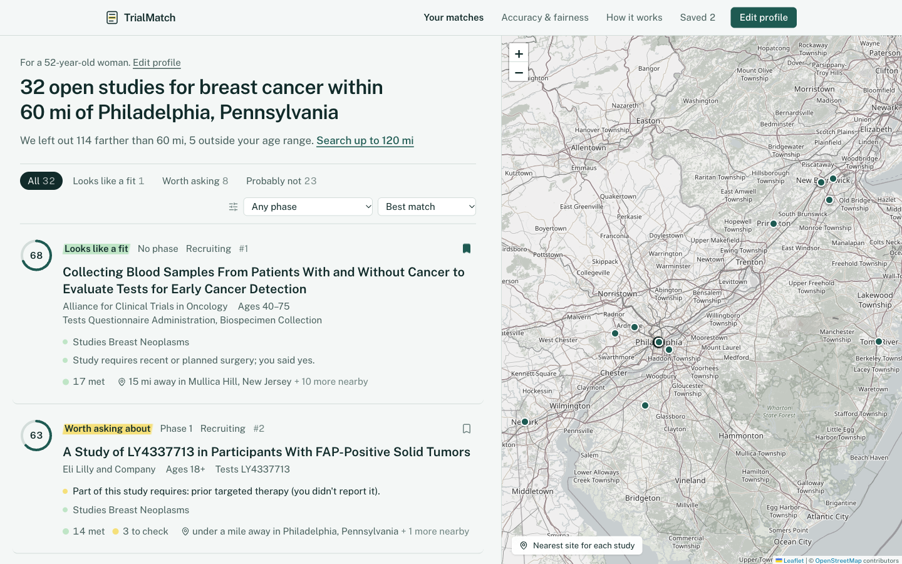
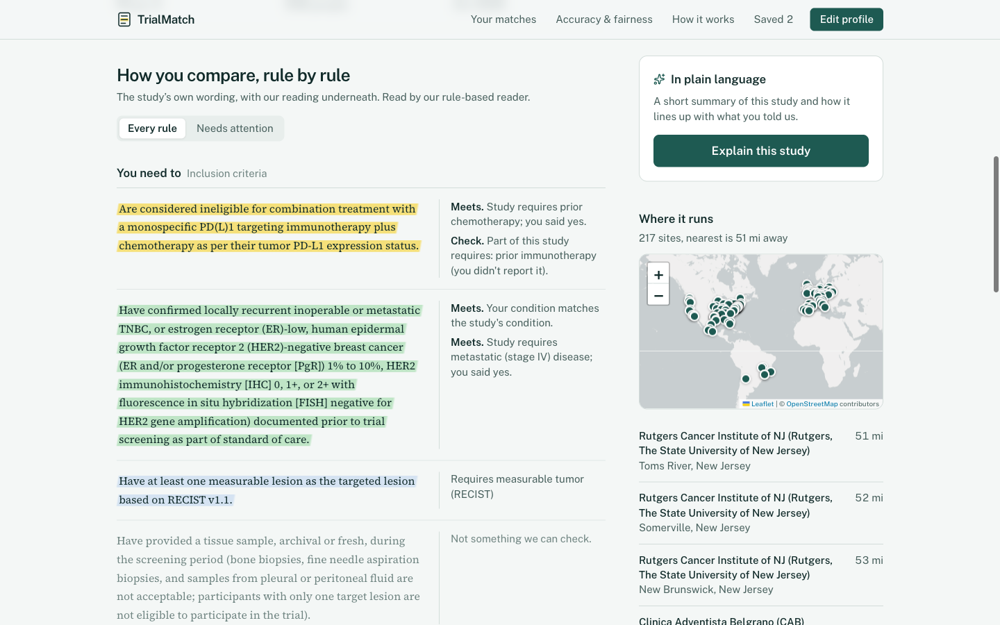
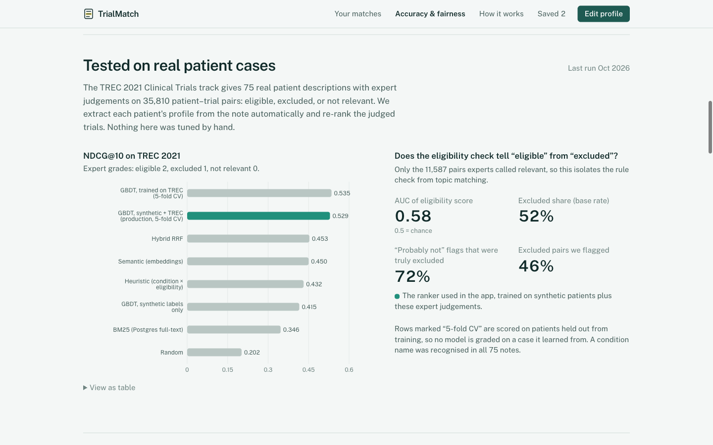

# TrialMatch

**Find clinical trials you might qualify for, with every eligibility rule read and explained.**

Patients struggle to find trials because eligibility criteria are long, technical free text. TrialMatch takes a short health profile (or a description in your own words), finds open US studies, checks each study's eligibility rules against the profile, ranks the studies, and explains every match: what you meet, what conflicts, and what to ask your doctor.

> ⚠️ **Not medical advice.** TrialMatch is a research prototype built on public ClinicalTrials.gov listings. It can be wrong. Only a study team can confirm eligibility.



| | |
|---|---|
|  |  |

---

## Features

**For patients**
- **Guided intake:** condition search with suggestions, age and sex, location with travel radius, and optional health details. Skipped questions are treated as unknown, never as "no".
- **Describe it in your own words:** free text is turned into a pre-filled profile (age, sex, conditions, history, with negation such as "I don't smoke").
- **Ranked results with a map:** a match score and verdict per study, the reasons for and against, nearest sites, filters, and a transparent "we left out 113 studies farther than 60 mi" note.
- **Annotated criteria:** each eligibility rule in the study's own words, highlighted as meets / conflicts / check / study team checks, with our reading beside it.
- **Plain-language explanation:** an AI summary checked by guardrails, labelled as AI-written, with a template fallback.
- **Saved studies and a printable summary:** a one-page "studies to discuss with my doctor" PDF, with conflicts, sites, contacts and questions.
- **Similar studies:** nearest neighbours in the embedding space.
- **Privacy:** the profile stays in the browser tab, and saved studies stay in the browser.

**Under the hood**
- **Data:** scheduled ingestion from the ClinicalTrials.gov v2 API into Postgres: about 2,600 open US trials across 26 conditions, with about 79,000 geocoded sites.
- **Rule reading:** eligibility text is split into lines and mapped onto a shared vocabulary of 40 concepts, with polarity, thresholds and timeframes.
  - A rule-based parser (with NegEx-style negation) is the baseline and fallback.
  - A free OpenRouter LLM re-reads the busiest trials.
- **Retrieval:** Postgres full-text search plus pgvector cosine search, fused with reciprocal rank fusion.
- **Ranking:** a gradient-boosted model over 23 query–trial features, trained on synthetic patients plus 75 expert-judged TREC patients.
- **Guardrails:** each AI explanation is checked against the rule check it was written from.
- **Evaluation:** parsing accuracy, a real-patient benchmark (TREC), synthetic ranking, explanation faithfulness, and a fairness audit, all shown in the app at `/insights`.
- **Gold-standard tool:** `/annotate` for reviewing and correcting labels. Once 30 lines are verified, the evaluation switches to them automatically.
- **Ops:** Docker Compose (pgvector, API, worker, web), GitHub Actions CI, an LLM quota guard, and a log of every LLM call.

## Results

### 1. Reading eligibility rules

139 criterion lines (133 rule labels), sampled from the corpus.

| | Rule-based | LLM (Nemotron 3.5 Super, free) |
|---|---|---|
| F1 | 0.882 | **0.931** |
| Precision | 0.863 | **0.896** |
| Recall | 0.902 | **0.970** |
| Operator / threshold accuracy | **0.954** | 0.941 |
| False alarms on lines with no rule | **29%** | 42% |

The minimum age read from the free text agrees with the registry's structured age field for 93% of trials.

### 2. Real patients: TREC 2021 Clinical Trials track

The benchmark has 75 patient notes with expert judgements on about 35,000 patient–trial pairs (eligible / excluded / not relevant). Profiles are extracted from the notes automatically, and each patient's judged pool is re-ranked. Expected run time is about 15 minutes with `make trec`.

| Method | NDCG@10 | P@10 (eligible) | MRR (eligible) |
|---|---|---|---|
| Random | 0.202 | 0.145 | 0.273 |
| BM25 (Postgres full-text) | 0.347 | 0.268 | 0.405 |
| Semantic (embeddings) | 0.450 | 0.333 | 0.526 |
| Hybrid RRF | 0.453 | 0.341 | 0.548 |
| Heuristic (condition × eligibility) | 0.432 | 0.352 | 0.553 |
| GBDT, synthetic labels only | 0.416 | 0.345 | 0.541 |
| GBDT, TREC labels only (5-fold CV) | **0.535** | 0.439 | **0.622** |
| **GBDT, synthetic + TREC (production, 5-fold CV)** | 0.529 | **0.451** | 0.599 |

Cross-validation folds are split by patient, so no model is scored on a patient it was trained on.

**Eligibility check alone** (11,587 pairs judged relevant):
- The eligibility score separates eligible from excluded with an **AUC of 0.58**.
- Studies flagged "probably not a fit" were truly excluded **72%** of the time, against a 52% base rate.
- The flags catch 46% of excluded pairs.

The main lesson: a ranker trained only on synthetic patients **didn't transfer** to real ones; it scored below plain hybrid search. The production ranker is now trained on synthetic patients (which teach distance and eligibility, since TREC has no locations) plus all TREC judgements, which raises NDCG@10 on held-out real patients from 0.42 to 0.53.

### 3. Ranking on synthetic patients

260 patients built from real trials, with 52 held out. Labels are derived from MeSH relationships, so compare methods rather than reading absolute values.

| Method | NDCG@10 | MRR (seed trial) | Recall@10 |
|---|---|---|---|
| BM25 (Postgres full-text) | 0.410 | 0.186 | 0.254 |
| Semantic (embeddings) | 0.404 | 0.181 | 0.275 |
| Hybrid RRF | 0.429 | 0.179 | 0.287 |
| Heuristic (condition × eligibility × distance) | 0.713 | 0.366 | 0.787 |
| **Learned GBDT (synthetic only)** | **0.773** | **0.468** | **0.817** |

### 4. AI explanations

10 explanations were audited against the rule check. Lower is better for every row.

| Share of explanations that… | AI as written | **AI + guardrail** | Template |
|---|---|---|---|
| Claim eligibility or advise enrolling | 0% | **0%** | 0% |
| List a conflict as a reason it fits | 0% | **0%** | 0% |
| Call something unclear that you answered | 0% | **0%** | 10% |
| Leave out a detected conflict | 10% | **0%** | 20% |
| Reading grade (Flesch-Kincaid) | 8.8 | **8.8** | 10.2 |

Building this audit surfaced two real bugs, both fixed:
- Reason text said "you didn't report it" when the patient had answered no, which the model then echoed as "unclear".
- The concept reader didn't recognise the phrase "heart disease".

### 5. Fairness

The audit counts studies reachable within 100 miles over 10 conditions × 6 age bands × 2 sexes × 19 US locations.

- **Large cities 24.9 → small cities 7.5 → rural towns 1.4** reachable studies. Rural reference towns get about 6% of what cities get.
- The Midwest reference locations get 35% of the best-served region (Northeast).
- People aged 85+ get 81% of the matches of 50–64 year olds. 44% of depression trials and 42% of asthma trials exclude people over 75.

### Caveats

- **The gold labels are AI-drafted and not yet human-verified.** Review them at `/annotate` (or edit [`criteria_gold.jsonl`](backend/data/gold/criteria_gold.jsonl)) before citing the parsing numbers. The tool can also add uniformly random lines, which avoids the current sampling bias: most lines were sampled where the rule parser had already found a concept, which flatters its recall.
- Several rule-parser fixes were made after looking at evaluation errors, so the rule parser's score is somewhat optimistic.
- The explanation audit is automatic and covers 10 cases, limited by the free LLM quota. It checks consistency with the rule check, not medical correctness.
- The fairness audit measures access to listed trials, not medical eligibility.

## Architecture

```
ClinicalTrials.gov API ──► worker (scheduled) ──► Postgres + pgvector
                               │  ingest → rule parse → embed → LLM-parse busiest trials
                               ▼
     trials · sites · parsed_eligibility · llm_calls · explanations · gold_annotations · eval_reports
                               │
Browser ──► Next.js (/api rewrite) ──► FastAPI
  wizard · results+map · trial view        /match: FTS + vector → RRF → eligibility check
  saved summary · insights · annotate              → 23 features → GBDT ranker
                                           /trials/{id}/evaluate · /similar · /explain (+ guardrails)
                                           /profile/extract · /annotations · /insights

TREC benchmark ──► separate database (trialmatch_bench) so closed historical trials never reach patients
```

## Running it locally

Requirements: Python 3.9+, Node 22+, and Postgres 15+ with the `vector` extension.

```bash
cp backend/.env.example backend/.env       # add OPENROUTER_API_KEY
make db
make pipeline          # ingest → parse → embed → train → parsing eval → fairness  (about 5 min)
make trec              # optional: TREC benchmark in a separate database (about 15 min)
make llm-parse         # optional: LLM-parse the busiest trials (uses free quota)

make api               # FastAPI on :8000
make web               # Next.js on :3000   (cd frontend && npm install first)
```

Docker: `docker compose up --build`. The worker runs the pipeline on first start, then refreshes every 24 hours.

### Tests

```bash
make test                          # backend unit + API tests, frontend typecheck + lint
cd frontend && npm run test:e2e    # Playwright journeys against the running app (desktop + mobile)
```

### Re-running evaluations

```bash
cd backend
python -m scripts.cli eval-parsing --with-llm   # about 10 LLM calls
python -m scripts.cli eval-explain --limit 10   # 10 LLM calls; --reaudit re-scores saved outputs for free
python -m scripts.cli train                     # synthetic ranking eval + production ranker
python -m scripts.cli fairness
```

### LLM quota

The OpenRouter free tier allows 50 requests a day. The app caps itself at `LLM_DAILY_BUDGET=40` and logs every call. Parsing sends about 3 calls per trial (15-line chunks, because long calls time out on free models). When the budget runs out, everything falls back to the rule parser and template explanations.

### Annotation in a shared deployment

Set `ANNOTATE_TOKEN` in `backend/.env` so that only people with the token can save labels.

## Project layout

```
backend/app/
  ctgov.py, ingest.py          ClinicalTrials.gov client and upsert
  vocab.py                     shared eligibility concept vocabulary
  parsing/                     rules.py, llm_parser.py, service.py
  profile_extract.py           free text → profile (no LLM)
  matching.py, search.py       criterion evaluation, hybrid retrieval, ranking, summaries
  ranking/                     features, training, offline evaluation
  explain.py, guardrails.py    AI explanations and their checks
  annotations.py               gold-standard store
  evaluation/                  parsing_eval, trec, explain_eval, fairness
  api/routes.py, main.py       FastAPI;  worker.py: scheduler
backend/data/gold/             AI-drafted gold labels
frontend/src/app/              /, /match, /results, /trials/[id], /saved, /insights, /annotate, /about
frontend/e2e/                  Playwright journeys
```
